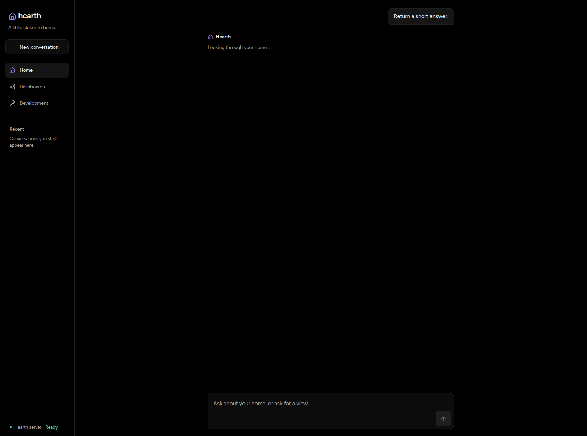
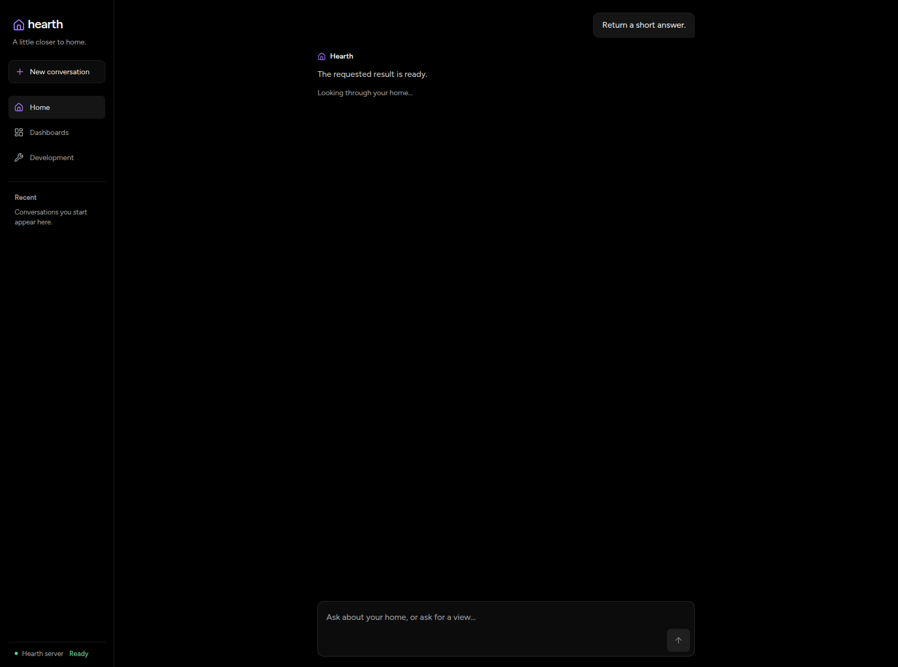
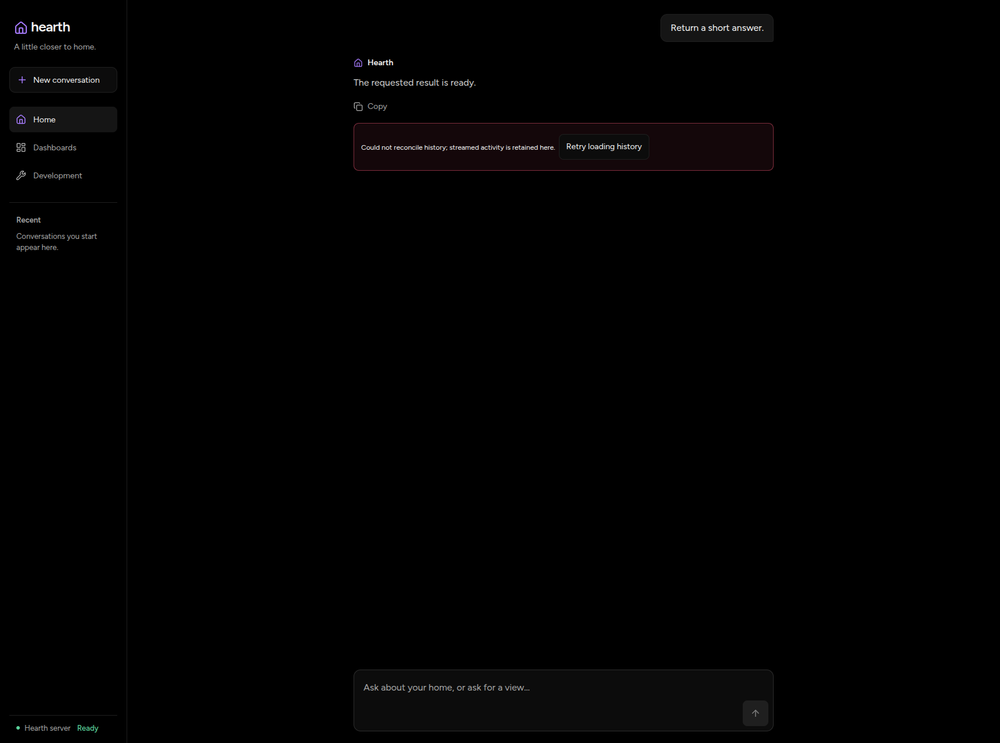

# Display committed replies before history reloads

The browser now renders `turn.finished.reply` immediately. History reconciliation
still owns the final row identities and admission of the next message. If history
fails, the committed reply remains visible alongside the recovery notice.

## Controlled browser comparison

The unchanged production build at `e73e249d15feb47bee2a04e07fb08369777ab10b`
was compared with that base plus this PR's `runtime.ts` and `AgentPage.tsx` changes.
Both builds used the same Chromium 156 browser, 1714 × 1275 viewport, and synthetic
HTTP responses. The terminal SSE response was immediate; the history response
was deliberately held for 1,000 ms after the browser requested it.

The metric is the time from the SSE resource's `responseEnd` to the reply entering
the DOM, observed by a MutationObserver. It is not a paint timestamp or model
latency. Five alternating runs per build followed separate diagnostic runs.
No live-model calls, builds, or tests ran during this comparison.

| Build | Median | Range |
| --- | ---: | ---: |
| Before | 1,065.1 ms | 1,064.3–1,066.5 ms |
| After | 52.8 ms | 52.6–53.0 ms |

Every before run withheld the reply until history returned. Every after run
displayed it while history was pending. All ten runs submitted one turn, kept the
composer disabled while history was pending, and ended with exactly one reply.
The measured difference removes the deliberately introduced history wait; it does
not establish a one-second saving on a normal connection. Raw runs are in
[timings.json](timings.json).

The process ran on a shared 24-core Linux host (load average 2.30 before the
comparison). Other users' processes were not stopped. Browser scheduling and
automation overhead remain in the absolute timings. The held-response experiment
isolates the history dependency, not CPU or provider performance.

## Visual evidence

Captured on 2026-11-10 through the browser tool. The installed agent-browser CLI
could not load its guide; no tooling was installed or upgraded. These are the real
Hearth builds with controlled API responses, not live-model performance footage.

Before: the terminal reply is available, but history is held.

After: the reply is visible while the same history request is held.

After: a history failure preserves the reply and offers recovery.

[Watch the comparison and recovery failure](reply-comparison.mp4). The clip is
trimmed from the original recording, with no speed change. It is illustrative;
the measured runs were recorded separately without video capture. Browser retry
was also verified to reconcile to one reply without submitting another turn.

## Exploratory live-agent baseline

The unchanged Core ran with worktree-local simulated Devices and the checked-in
configuration: OpenCode Go, `deepseek-v4.1-flash`, low reasoning, ten maximum model
cycles per turn. There were 23 paid user turns: one browser smoke journey and
22 timed API journeys. The timed journeys retained 72 completed model responses.
Provider retries, cache hits, and reasoning-token usage are not fully represented
by the retained metadata, so these counts are not a billing report.

| Journey | Runs | Median completion | Range | Model cycles |
| --- | ---: | ---: | ---: | --- |
| One temperature card | 3 | 6.29 s | 4.62–7.80 s | 3–4 |
| Power Command | 3 | 10.84 s | 5.30–13.75 s | 4–5 |
| Three-card dashboard | 3 | 7.91 s | 5.90–9.07 s | 3–4 |
| Automation proposal | 3 | 8.85 s | 8.15–13.36 s | 5 |
| Eight-card view and nine follow-ups | 10 | 6.31 s | 5.70–9.25 s | 4 initially, then 2 |

These are baseline observations, not before/after comparisons or reliability
estimates. The follow-ups share one growing conversation; they are not independent
samples of one fixed workload and do not approach the history-budget boundary.
Provider/cache conditions were not controlled. API timings do not establish
browser first paint or composer-ready time.

All requested temperature bindings matched the discovered simulator inventory.
Each Command was checked by its returned ID, satisfied outcome, and linked State
Observation. Each proposal had the requested button trigger and one power-only
step; the saved Automation list stayed unchanged. A collector assertion initially
used the wrong Command tool name. Its original failure was preserved, the existing
receipt was verified without resubmission, and collection resumed at the next
planned turn. No model request was retried by the collector.

### Next candidates

- All 19 timed visual turns made a final model cycle after the artifact committed.
  The post-artifact tail was a median 1.08 s, range 0.82–2.14 s. Investigate explicit
  completion for a finished visual request rather than stopping every presentation
  unconditionally. Multiple artifacts and mixed action requests must still finish.
- Fresh first generations already used 22,754–22,787 prompt tokens. The model sees
  34 MCP tools plus the skill tool. A `list_entities` result reached 43,543 bytes.
  Compact discovery and task-appropriate tool schemas deserve measurement before
  CPU micro-optimizations.
- The eight-card conversation's first-generation prompt grew from 22,776 tokens
  to 54,114 tokens by turn ten. This establishes context growth, not a measured
  slowdown; preserving grounded follow-ups matters when evaluating compaction.
- The 62 streamed tool durations, including result persistence, had a median
  9.85 ms and maximum 64.82 ms. This baseline does not implicate tool execution
  as the main wait. No CPU ceiling or provider-internal bottleneck was measured.

Raw baseline events, retained-history analysis, collector scripts, and logs remain
local under `.data/verification/agent-ux/`. Household-independent controlled timings
and media are published here; raw provider metadata is not.

## Verification

- Before the fix, both new nonempty-reply component cases failed at the missing
  reply assertion. The two visual-only cases passed.
- After the fix, all 34 focused conversation/page tests passed.
- Browser checks covered delayed history, failed history, and recovery without a
  duplicate reply or another turn submission.
- Component tests also preserve cards, empty replies, hidden tool narration, and
  composer blocking before stream closure and during reconciliation.
- `mise run validate` passed, including frontend typecheck/build and the default
  backend unit, integration, and E2E levels. No generated or module changes resulted.
- Independent read-only review found no defects. Its suggested explicit
  pending-history composer assertion was added before full validation.
