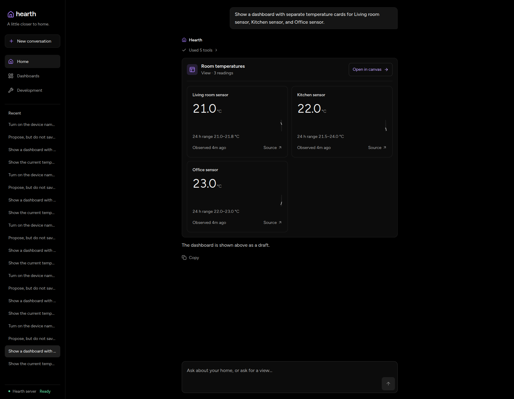
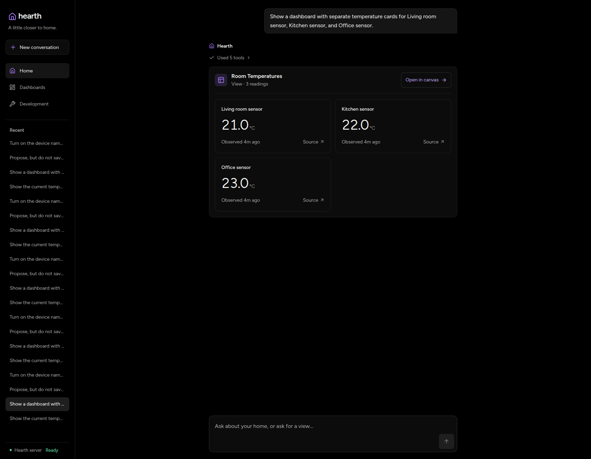
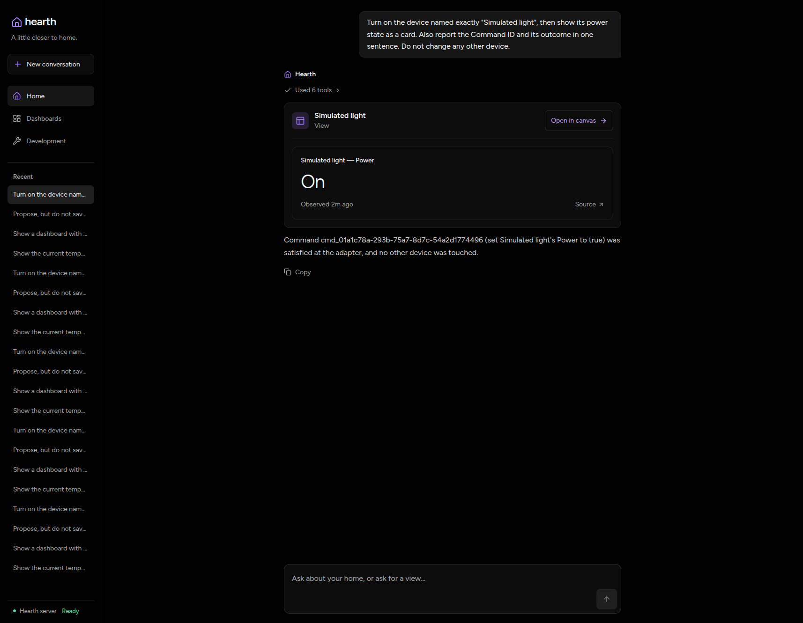
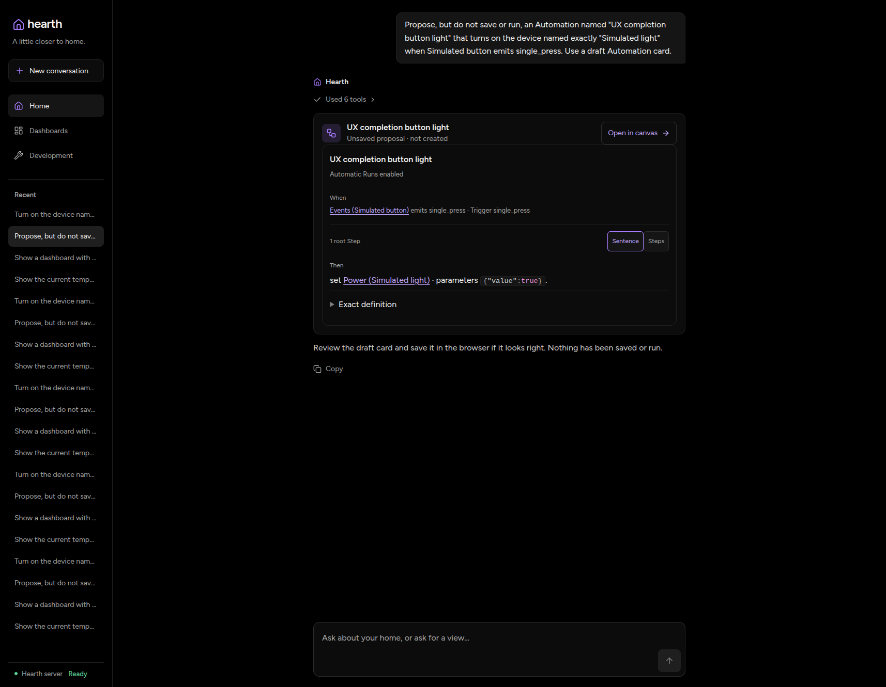

# Explicit visual completion

This change lets an eligible final presentation complete a turn without another
provider generation. It does not make discovery, reasoning, or card generation
faster. The model must choose `complete_turn: true`; action turns still continue
through the provider for their outcome reply.

## Results

The dashboard's median post-artifact tail fell from **1,208.3 ms to 2.8 ms**:
a 1,205.4 ms reduction (99.8%) in that specific interval. The five baseline tails
ranged from 992.0 to 2,041.0 ms; the five candidate tails ranged from 2.8 to 4.7 ms.
All five candidate dashboard turns completed locally after their presentation.
Retained messages establish the mechanism: no further provider generation,
rather than a faster final generation.

| Workload | Original checks passed, baseline/candidate | Median post-artifact tail, baseline/candidate | Candidate local completions |
| --- | --- | --- | --- |
| Single temperature card | 4/5 and 5/5 | 1,346.9 / 2.8 ms | 5/5 |
| Three-card dashboard | 5/5 and 5/5 | 1,208.3 / 2.8 ms | 5/5 |
| Automation proposal | 5/5 and 5/5 | 1,344.7 / 1,289.4 ms | 0/5 |
| Command with power card | 4/5 and 4/5 | 1,828.3 / 1,418.3 ms | 0/5 |

This table uses trials that passed the original collector checks. It is not a
claim that every passing output was identical: the later output audit found
duplicate baseline presentations in single-card trial 25 and dashboard trial 35.
Both retained the requested bindings, so the collector did not reject them.
The dashboard metric starts after the **last** artifact and excludes the extra
presentation work. Excluding both sides' fifth dashboard trial still gives
1,130.4 versus 2.8 ms, but that four-pair sensitivity check is not a replacement
five-run benchmark.

All 40 scheduled turns were submitted exactly once. They retained 176 provider
generations and 10 local completions. All ten candidate temperature-card turns
used the flag; none of the five Automation proposals did. Automation proposals
therefore show **no measured benefit from this mechanism**. The deterministic
tests prove that a marked Automation presentation can finish locally, not that
the live model reliably chooses the flag.

There is **no broad end-to-end speedup claim**. Model discovery paths, optional
trends, duplicate baseline artifacts, provider/cache state, and two collection
interruptions varied. Whole-turn latency remains dominated by provider work
before presentation. Here are all five observed turn durations per workload,
including trials whose collector checks failed:

| Workload | Baseline median (range), seconds | Candidate median (range), seconds |
| --- | --- | --- |
| Single temperature card | 6.65 (5.47–8.55) | 4.81 (4.28–5.50) |
| Three-card dashboard | 6.93 (5.95–11.18) | 6.35 (4.20–7.67) |
| Automation proposal | 10.21 (7.11–11.30) | 8.97 (7.01–9.83) |
| Command with power card | 10.51 (8.07–11.50) | 10.77 (9.46–13.43) |

[Per-trial metrics and findings](measurements.json) retain all trials, generation
counts, output counts, errors, and timing ranges. These are API/SSE-receipt
measurements, not browser paint or composer-ready measurements.

## Comparison method

- Baseline: parent PR #327, `fa444d76bc55486eed8468052a486b973dbbfb26`.
- Candidate: the child diff on `perf/agent-visual-completion`, with source hashes
  retained beside the local comparison ledger.
- Both builds use OpenCode Go, `deepseek-v4.1-flash`, low reasoning, the same
  simulator preset, separate SQLite/NATS storage, and loopback Core HTTP APIs.
- Four workloads each have five scheduled trials per build: one temperature
  card, three temperature cards, an unsaved Automation proposal, and a Command
  with a power card and outcome sentence. Every turn starts a fresh conversation.
- Trials alternate baseline/candidate. There is no paid warmup, collector retry,
  or browser-submitted model turn. Existing provider-SDK transport policy is
  unchanged; retained generations are not a count of transport attempts.
- Requested temperatures are paused at 21, 22, and 23 °C. The mixed workload
  resets the healthy simulated light to off and matches the reset Observation
  before asking the agent to turn it on. No physical Devices are involved.

The collector timestamps SSE receipt with a monotonic clock. Total latency runs
from submission until the response stream closes. Post-artifact latency runs
from receipt of the last presentation event to `turn.finished`. History reads
and correctness checks occur after the timed turn. Provider generations and
token usage come from a read-only copy of retained message data. Local terminal
rows count separately and must not claim provider usage.

Correctness checks require exact requested card bindings, the expected unsaved
Automation trigger/action, and one satisfied Command with its linked Observation
and a reply containing its ID and outcome. The collector also checks for
unrequested action-tool calls and saved Automations.

## Interrupted collection

The collector stopped at trial 17: the baseline's third single-card response
included an unrequested humidity card as well as the requested temperature card.
It also added explanatory text. This failed the exact-binding check; the
temperature card itself was correct. The first 16 trials passed.

The user approved finishing the remaining 23 original schedule slots. Trial 17
remains failed and is not replaced. Both stacks were stopped and restarted, and
the same fixed stimuli were restored before trial 18. Source hashes, prompts,
timing boundaries, and correctness checks are unchanged. The original collector
and stopped ledger remain available locally. This interruption and the baseline
failure limit broad performance claims.

The second stop was trial 39, the baseline's final mixed request. The model tried
unsupported operation `turn_on`, received `invalid_request`, read the Entity
contract, then used `set` successfully. The collector counted two tool attempts
as two receipts and failed its count assertion. The user approved the final
candidate trial after another restart; trial 40 recovered from the same input
error and hit the same assertion.

Both original count failures remain recorded. Read-only follow-up audits found
one satisfied durable Command per mixed trial, each linked to an applied
Observation, the requested power card, and the correct outcome reply. Each
build had exactly five durable Commands across its five mixed trials. There
were no duplicate effects or saved Automations. The budget ended at 40/40;
there were no replacement trials or additional browser model submissions.

The shared Linux host has 24 cores. Pre-collection load was 1.33 before the
first restart; launch-adjacent counters are retained for each collection segment.
No concurrent task-owned builds or tests ran during the timed turns. Unrelated
processes were not stopped. Remote provider work and cache conditions remain
uncontrolled.

## Verification scope

Deterministic tests cover both provider protocols, multiple artifacts, sibling
joining, modeled and persistence failures, cancellation, iteration limits,
history continuation, and action-summary continuation even when the model marks
a mixed request complete. Input-fidelity tests cover exact large integers,
nested duplicate keys, and `<`, `>`, and `&` through the MCP bridge. Public MCP
schemas and database schemas are unchanged.

Full `mise run validate` passed after the final functional correction. The earlier
focused agent integration run also passed with race instrumentation; the full
local gate does not use race instrumentation. Independent review's three
functional findings were corrected before collection.

Raw local evidence is under `.data/verification/visual-completion/` in the child
worktree. It includes the submission ledger, both collector versions, source
hashes, stack doctors, SSE/history records, and validation logs. Native provider
continuation is not published as public evidence.

## Browser evidence

Captured on 2026-11-10 in the real application at 1714 × 1331. The before/after
screenshots reopen each build's first dashboard trial with the same paused
readings. Layout and optional trends are model-selected, not this PR's UI changes.
The candidate source is the measured child diff; the baseline is the parent
revision above. These are retained-history checks, **not live timing proof**.

[History recovery recording](history-recovery.mp4) shows the candidate's fifth
dashboard trial surviving reload, then opens its final mixed trial with the
outcome reply. The 24.6-second recording is untrimmed, with no speed change.
Playback was inspected at its opening, middle, and end. It does not demonstrate
the provider-latency saving.

The installed agent-browser guide and its npm fallback were unavailable, so the
connected browser tool was used without installing or upgrading tooling. HAR
captures contain navigation-related dropped entries and are not a complete
request-count proof. Retained database counts independently confirm exactly
20 user turns per build after browser inspection. The browser session and both
owned simulator stacks were stopped; storage and local evidence were retained.
