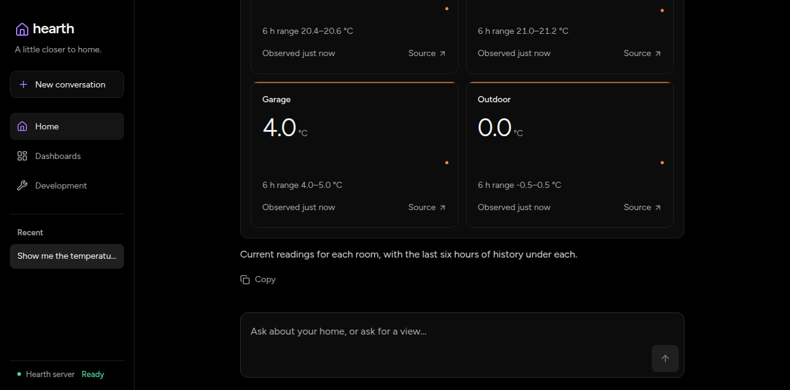

# Visual-only replies and model discretion

The agent can now finish with empty text after committing a visual in the current
turn. Empty answers without a current-turn presentation still fail. The prompt
discourages plan narration and recaps, and the browser excludes tool-call
preambles from the rendered reply while preserving raw history and tool activity.

## Live result and limitation

One local browser turn used the unchanged temperature starter with OpenCode Go,
DeepSeek V4.1 Flash, and low reasoning effort. The model presented a visual but
still added: "Current readings for each room, with the last six hours of history
under each." The preamble stayed hidden after reload; the final recap remained.

The user chose to keep model discretion rather than force the turn to end after
presentation. This change supports silence but does not guarantee that the model
chooses it.

## Capture and verification

- Captured on 2026-11-07 from this change on base `73b3bfc`, before committing.
  Viewport: 1280 × 633. Browser: Chromium 156 through agent-browser 0.41.2,
  using the installed 0.39.0 guide. No shared tooling was changed.
- The worktree-local production Core and UI used simulated Devices. No physical
  Adapter or household data was used. The screenshot is unedited and was inspected.
- The HAR recorded one conversation create and one streamed message submission.
  Other POSTs were read-only State history queries for the cards.
- Before-fix regressions rejected visual-only completion for both providers and
  restored preambles on reload. After-fix regressions passed, including rejected
  presentation and previous-turn artifact cases.
- `mise run validate` passed. The owned browser and simulator stack were stopped;
  local evidence and storage were retained.
- No before-fix browser screenshot was captured. Failing tests and the deployed
  conversation establish the baseline; this screenshot documents the live result
  and its remaining limitation, not successful elimination of every recap.
