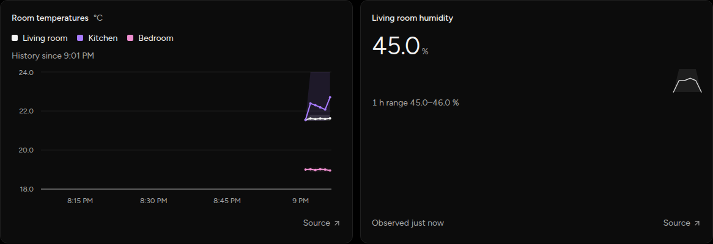

# Charts without a now marker

TimeSeries no longer draws an orange reference line at the end of its window,
and Metric trends no longer draw an orange dot at their latest point. The time
axis still ends at the window's end. Orange now marks only the primary action
and the afterglow on a changed reading.

## Capture and verification

- Captured on 2026-11-08 at revision `9f7ac3a`, viewport 1440 × 900, cropped to
  the two cards. Browser: Chromium 156 through agent-browser.
- The worktree-local Core and Vite UI used the scripted simulator preset; no
  physical Adapter or household data was used. The dashboard showed three room
  temperatures in a 1 h TimeSeries and a living-room humidity Metric with a 1 h trend.
- The before capture served the `origin/main` (`8a6b9c4`) versions of
  `TimeSeries.tsx`, `Trend.tsx`, and `index.css` from the same Vite process. The
  files were restored before the after capture. The captures are unedited apart
  from cropping.
- The trend's dot is too small to see at this size in either capture. The
  component tests assert that neither the reference line nor the dot renders.
