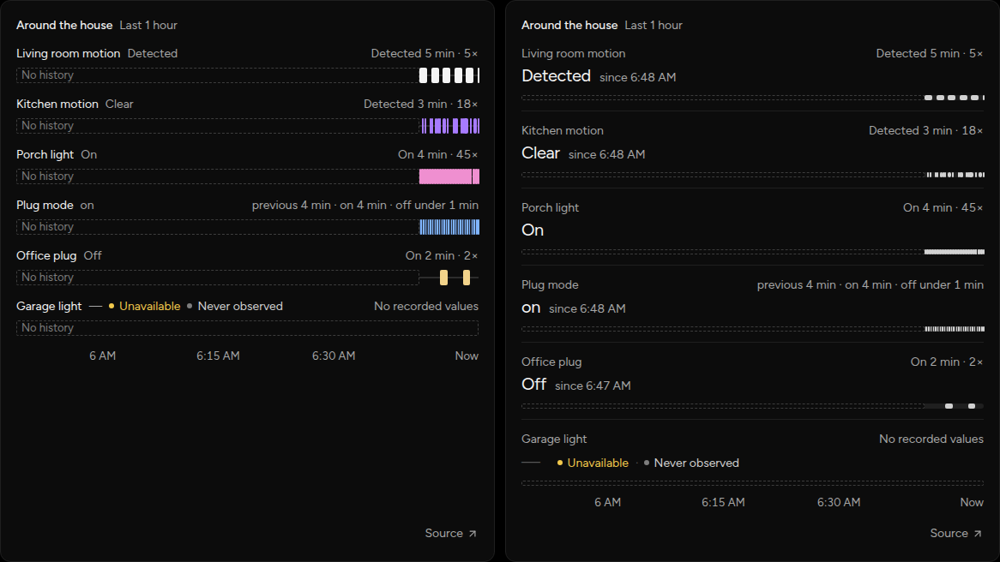
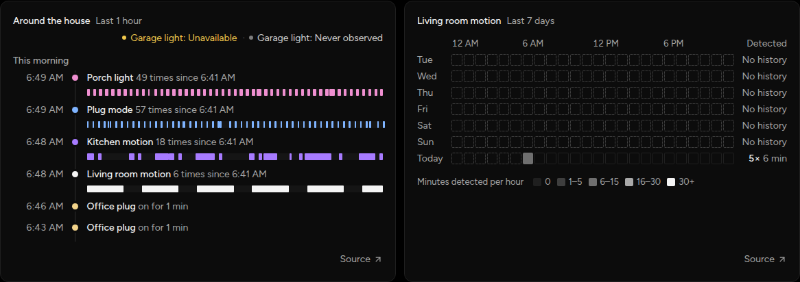
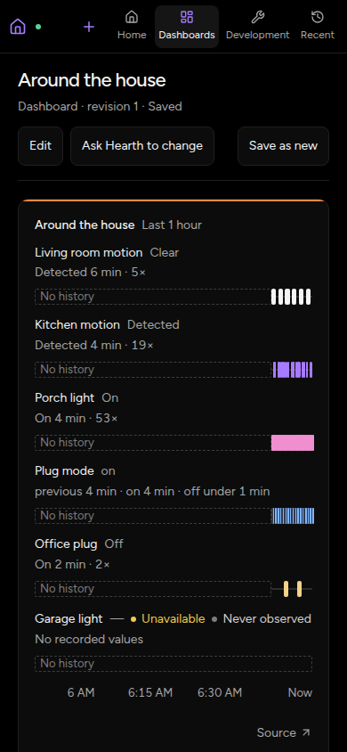

# State timeline and week pattern cards

Dashboards can now show when yes/no and text fields changed. `StateTimeline`
renders 1–12 fields over one window as lanes, a ledger, or a change feed;
`WeekPattern` shades one yes/no field by hour over the last 7 local days. Both
read Core's recorded [State changes](../../state-changes.md).

## Capture and verification

- Captured on 2026-11-09 from this branch in Chromium through agent-browser at
  1440 × 1000 (cropped to the cards) and 390 × 844. The worktree-local Core,
  simulator and Vite UI ran the scripted preset; no physical Adapter or
  household data was used. These are new cards, so there is no before state.
- Core started from this branch before the review fixes; those changed only the
  migration backfill (not exercised by the fresh database), a lint constant and
  web code, which Vite served live. The captures show the final web code.
- The saved dashboard used real simulated Entities, including an unavailable
  Adapter's light (shown as Unavailable · Never observed). A driver published
  56 extra changes over about nine minutes. The database was fresh, so earlier
  time reads "No history" and earlier week days are empty.
- The HAR recorded 126 `POST …/state/changes` reads (108 timelines, 18
  summaries), all 200, and no browser mutations. Screenshots are unedited apart
  from cropping.
