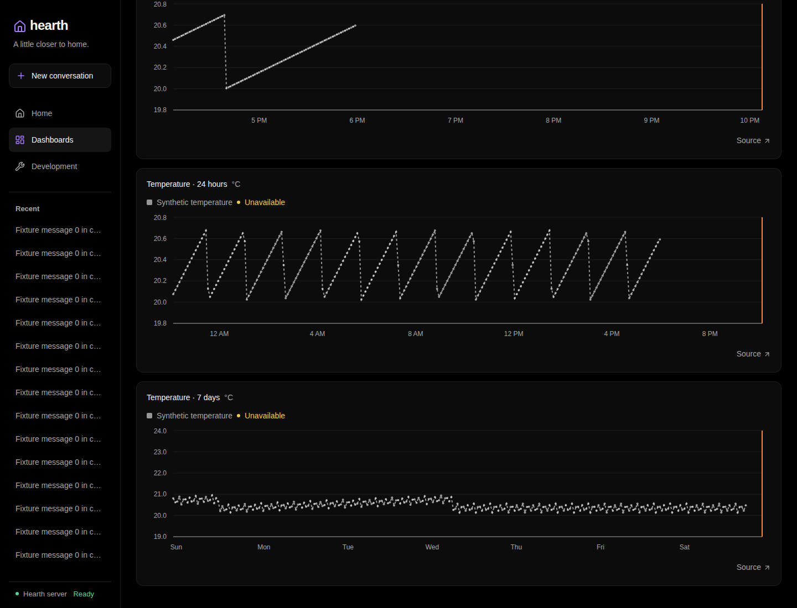
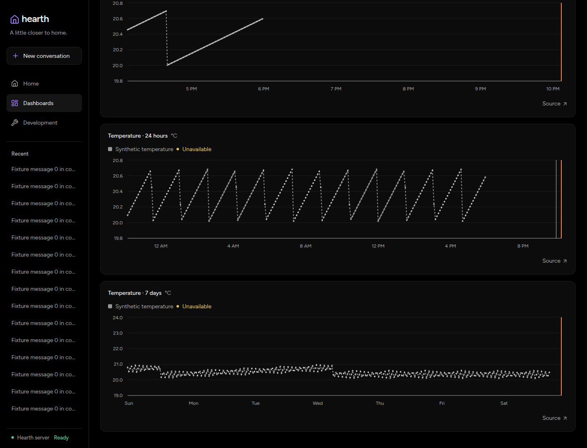

# History rollup verification

Measured on 2026-11-07 on the development machine: Linux amd64, 24 logical
CPUs, performance governor, Go 1.27.3, modernc SQLite v1.61.1 / SQLite 3.54.1.
Both sides use production `db.Open`: WAL, one connection, foreign keys on,
5-second busy timeout, and synchronous=FULL. Runs use warm caches without a
host cache flush. These are local descriptive results, not deployment forecasts.

The [measurement record](media/history-rollups/measurements.json) contains every
HTTP timing, append block result, binary hash, and source-fixture hash.

## Query and migration results

The baseline Core is clean revision `0c0f976`; the candidate is `aed8373` plus
the changes committed as `f219942`. The fixture starts at migration 29 with
1,440,004 Observations. For HTTP queries, two additional synthetic series each
add 324,000 reports, one every eight seconds over 30 days: integer temperature
and decimal humidity. Separate copies serve the old and migrated queries.

Each HTTP window has seven runs per side, alternating which side goes first.
Requests run serially through production Core, including response decoding.
Every request returned 200, the expected bucket count, and matching integer
metrics. No run was omitted. The table reports median and full range in ms.

| Window / buckets | Baseline | Candidate | Target |
| --- | --- | --- | --- |
| 24h / 288 × 5m | 92.77 (91.10–96.59) | 4.36 (4.07–4.68) | — |
| 7d / 336 × 30m | 682.17 (679.14–693.28) | 20.33 (18.10–22.54) | ≤50 |
| 30d / 288 × 150m | 2961.80 (2939.61–2986.20) | 82.70 (80.73–84.46) | ≤100 |

The fixed ranges end at `2026-11-08T00:00:00Z`. Six separate output comparisons
cover integer temperature and decimal humidity over 24h, 7d, and overall 7d
summaries. Integer metrics and decimal extrema match; decimal means meet the
relative `1e-12` tolerance. Regression tests cover exact sums beyond int64,
large-value cancellation, live/backfill agreement, and long overall ranges.

An excluded CPU profile identified cell decoding and numeric comparisons as
the candidate read costs. Selecting fewer repeated columns and comparing like
numeric representations natively reduced those costs. Queries still read and
merge every selected minute cell, but no longer decode every raw report.

Migration 30 produced 959,920 cells from 1,440,004 Observations in **15.965 s**,
below the 60-second target. This is one startup measurement, from process start
to the `database_migrated` log event, with no concurrent benchmark workload.

## Append results and accepted exception

The original `dbload compare` produced no baseline measurements. Its provenance
lookup discovered candidate SQL files and tried to read them at the old
revision, where `history_rollups.sql` does not exist. The failed campaign was
retained, not counted as an ingest result.

The approved replacement uses five alternating standalone `dbload run` blocks
per side, 200 attempts per case per block, concurrency one, and each binary's
own `-source-root`. Every block starts from a fresh prepared fixture copy;
the tool runs three warmup operations before the timed attempts. The baseline
is clean `f529c1a` (`0c0f976` plus measurement-only numeric workload code), and
the candidate is clean `ea4dd4e`. The numeric workload source is byte-identical
on both sides (SHA-256 `32fa7cf89987bb52675027295cf8ecd5f4842da468c1d350a6cac9a551494b48`).

All 4,000 attempts completed with the expected work and returned State projection
and pending Device Fact IDs, with zero errors or timeouts. The numeric case
checked the committed operation result; the campaign did not independently
recount its persisted rows. The final tooling also applies the existing untimed
Observation-count oracle to that case. Values below are the median
of five block p95 values and their full range, in ms.

| Case | Baseline | Candidate | Original ≤10% gate |
| --- | --- | --- | --- |
| Boolean append | 7.80 (5.44–8.35) | 6.66 (3.73–7.89) | Pass |
| Numeric append | 5.70 (3.84–6.89) | 7.80 (6.74–7.98) | **Fail: +36.9%** |

The user explicitly accepted the numeric exception, retaining transactional
exact accumulation instead of changing durability or adding asynchronous work.
The original numeric threshold did not pass. These noisy block results do not
establish statistical equivalence or a precise causal regression.

Excluded diagnostics support storage synchronization as the dominant elapsed
cost: the candidate CPU profile recorded 160 ms CPU over 2.17 s elapsed.
Separate syscall traces recorded 216 `fsync` calls on each side, totaling
2.174 s candidate versus 1.081 s baseline. Those totals include untimed setup
and verification, so they are diagnostic, not a replacement latency comparison.

## Browser evidence

The real old/new Vite dashboards proxy isolated task-owned Core instances and
use the same synthetic saved dashboard and source data. No physical household
or hosted model is involved. At a 1440 × 1100 viewport, all four charts rendered.
Captured HTTP responses confirm the old 288-point windows and the new
60/360/288/336-point windows, with `select_field`, aligned starts, and no query
errors. Source details opened successfully. Fixture Devices are intentionally
offline; historical series remain visible with the Unavailable disclosure.

The baseline frontend is `0c0f976` (measurement-only Go changes do not affect it);
the candidate frontend is `ea4dd4e`. Subsequent cleanup changes no browser code.
Screenshots are unedited and use wall-clock ranges captured a few minutes apart.
They establish rendering, not latency. The timing comparison above uses fixed
ranges instead.

| Before | After |
| --- | --- |
|  |  |

Raw logs, HARs, profiles, fixtures, and failed-campaign evidence remain under
`/tmp/opencode/rollups` on the measurement host. The linked measurement record
and screenshots are the reviewable subset; raw host artifacts are not public.

## Integrated checks

After cleanup, `mise run validate` passed, including all 453 frontend tests,
the web build, lint, vet, generation, and the default Go unit/integration/E2E
levels. Some unchanged Go packages used the test cache. The separate
`mise run dbload-test` passed, including the numeric append count oracle.
Local Go tests ran without race instrumentation; CI enables it.

Independent correctness review confirmed the arithmetic redesign. Cleanup
removed pass-through numeric aliases/wrappers, moved their classification
assertions to the shared package, and corrected stale ownership docs/comments.
Task-owned Core, NATS, Vite, and browser processes were stopped; retained
fixtures and evidence were preserved. No deployment or `wanda` check was run.
